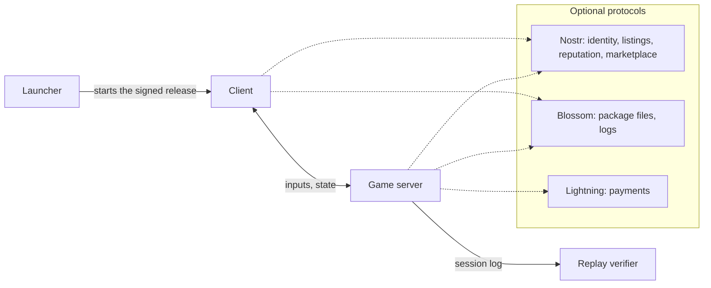

# Campfire

## Vision

An open-source (MIT/Apache-2.0) Rust engine for multiplayer games, with its server and client, plus importers that bring existing games onto it from the player's own copy, Generals: Zero Hour first. Anyone can host a server, create content and set their own rules; the project runs nothing and ships defaults, not policy.

Four pillars all ship:

1. **Engine:** genre-free, deterministic, scriptable.
2. **Network:** one authoritative server per session, prediction, verifiable session logs.
3. **Bitcoin and Nostr:** identity, discovery, reputation and optional Lightning payments.
4. **Imported games:** so close to the original that no player notices a difference.

Docs: [Engine Core](02-engine-core.md) · [Game Scripting](03-game-scripting.md) · [Capabilities](04-capabilities/00-overview.md) · [Games](04-capabilities/games.md) · [Protocol Spec](05-protocol-spec.md) · [Research Notes](06-research-notes.md) · [MOBA test content](07-moba.md) · [Script API](08-script-api.md) · [Determinism Core](09-determinism-core.md) · [Sessions](10-sessions.md) · [RTS foundations](11-rts-foundations.md) · [Zero Hour](12-zero-hour.md) · [Wide bodies, uses, the shop and gravity](13-bodies-uses-shop-gravity.md) · [Replication audiences](14-replication-audiences.md) · [QUIC transport](15-quic-transport.md)

## Guiding principles

- **Defaults, not enforcement.** Ownership checks, payments, character bans and rankings are options each host turns on.
- **Human trust over surveillance.** An open-source client cannot be trusted, so anti-cheat lives on the server only. The game is built first for people who trust each other; on a server open to strangers, players rely on server-side checks and reputation, and play at their own risk, above all in wagers. The defaults keep wagers and spectator bets off.
- **Protocols over platforms.** Identity, listings, reputation and the marketplace use Nostr and Lightning, so no one, this project included, is a chokepoint.
- **Licensing.** Code: MIT/Apache-2.0, importers and rules packages included. An imported game's content belongs to its publisher: it stays on the player's machine, and nobody distributes it. Community content picks its own license.

## Terms

| Term | Means |
| --- | --- |
| Match | A game with an end: waiting → running → ended |
| World | A persistent game that never ends |
| Session | One match or one world on one server, with one session id and one session log; a restart continues it from its latest save |
| Segment | The part of a session log from one checkpoint; a match with no save is one segment |
| Save | A checkpoint a player keeps, with the log before it, to continue later, on the same engine release or a newer one |
| Carry | Declared, typed data that leaves one session and enters another as a recorded input: a hero between missions |
| Campaign | Missions, each a mode, played in an order the carry opens |
| Team | A side players and units belong to; a mode declares any number, and how each pair regards each other |
| Unit | Anything in the sim with a stable id, a position and a type: a hero, a building, a projectile, a door |
| Action | Anything a unit does on purpose; every action runs one pipeline |
| Tag | A word a unit carries, from its type or its modifiers; the mode says what it does |
| Params | Read-only values from data files |
| Script state | Declared values scripts keep on units and the mode; part of the game state |

## System overview

Three programs share one deterministic engine: the client, the game server, and a replay verifier anyone can run on the packages a session names. Payments and ownership plug into the server as optional modules.

A launcher starts the right client: a server names an engine release tag, and the launcher fetches that release only if enough of the release keys it trusts signed it (for example 2 of 3), and refuses revoked releases. The launcher itself is signed for each OS.

## Engine

The engine knows no genre. It provides capabilities, one mechanism each (health and damage, units that take orders, a first-person character, fog of war, items), and a game declares the ones it needs. The core has no genre words: a mode declares its own damage kinds, stats, pools, tags, slot kinds, teams and relations, and every capability says its mechanism in one model ([The model](04-capabilities/00-overview.md#the-model)), so a MOBA, a shooter, an RTS, an MMO and a battle royale are the same kind of package.

- **Deterministic:** the same inputs give the same result on every machine.
- **Tick rate:** set by the host within the mode's range, fixed for the session.
- **Platforms:** desktop only (Windows, Linux, macOS); on x86-64 the CPU needs x86-64-v3 (AVX2 and FMA). The client is 3D.
- **Tools:** importers, map and content editors, dedicated server, replay verifier.

## Multiplayer model

One server is the single authority for each match or world. Peer-to-peer was rejected: every player would hold the full state, and fog of war could be read.

- **Players see only what they should:** hidden information never reaches their machine ([Replication audiences](14-replication-audiences.md)).
- **Every result is verifiable:** anyone who holds a session's packages can replay its log on the release it names and confirm that the result follows from the logged inputs. The log does not prove the host fair ([What verification proves](05-protocol-spec.md#verification)).

**Anti-cheat** runs on the server only: no kernel drivers, no scanning. Hosts get checks that every action is possible (range, cooldown, resources, sight); limits on action rate and inhuman reaction times; detection plugins that read session logs; community review, where a reported replay goes to reviewers other players trust and their verdicts are Nostr reputation statements; tools to flag and ban identities; and reputation and stake caps for new identities.

## Scale: from matches to large worlds

One server always owns its whole match or world; servers never connect to each other, and share what they share as Nostr events.

| Size | Example games | Players (goal) | Verified by |
| --- | --- | --- | --- |
| Match | MOBA, arena, duel | 2–20 | Replaying the whole match |
| Battle | Battle royale, large siege | 20–200 | Replaying the whole match |
| World | Persistent MMO-style world | 1,000+ on one server | Replaying any period from a checkpoint, after a delay |

A world is one session: its dungeons are regions of the same sim, which at 1,000+ players needs deterministic multithreading, strict relevance and dormant regions ([World](04-capabilities/world.md)). A world's log shows hidden state that is still live, so the host publishes it after a delay it sets; a match publishes its log when it ends.

## Singleplayer and saves

A singleplayer game is a session with one player, on a server that runs as a thread of the client, as Minecraft's integrated server does: one code path for singleplayer, LAN and online play ([Local server](10-sessions.md#local-server)).

- **Saves.** The player saves when the mode allows; a save is a checkpoint with the log before it, and loading it starts a new segment of the same session ([Saves](02-engine-core.md#saves)).
- **Newer releases.** A save loads on its release and every later one, through converters each release carries, one way, as Factorio and Minecraft convert old saves.
- **Campaigns and characters.** What a hero or a character keeps between missions or play sessions is the mode's carry, so each session still verifies alone.
- **Pause and game speed.** The sim reads no clock, so a pause runs no ticks and a game speed runs more or fewer ticks a second; neither enters the log. Who may pause in multiplayer is the host's setting.

Players move between worlds by leaving one server and joining another. Their identity comes with them; items and progress come only if the new server accepts them, an item by burn and attest ([Item export](05-protocol-spec.md#item-export)).

## Scripting and modding

Characters, abilities, items, maps and whole modes are content anyone can create. Packages hold Rhai scripts and data; mechanisms come from capabilities in engine releases. Scripts are sandboxed, deterministic and resource-limited, so a script gives the same result on the server, in the verifier and in a client that plays back a published log.

**Content packages** bundle logic, balance data, art and sound, announced under the author's key and named by a fingerprint, so same-named content never conflicts; an imported package has only its fingerprint. Hosts pin exact versions, so an author's update reaches players only when the host chooses.

## Decentralized server network

No central server list or account system: Nostr provides both.

- **Identity:** a player is a Nostr key, which owns items and receives payouts on every server. The main key never reaches a server; it signs a short-lived key for each session ([Keys](05-protocol-spec.md#keys)). A published log names every player's main key, so the client lets a player keep several identities, one for each server.
- **Discovery:** servers publish signed listings (region, modes, content, rules, prices); LAN servers also announce themselves on the local network.
- **Reputation:** players and servers publish signed statements after matches, and each player chooses whom to trust. Servers may form groups that share bans, ratings and dispute handling.
- **Matchmaking** runs on each server.

**The host decides:** which modes, maps and characters are allowed, and whether ownership is enforced; tick rate, player limits, grace period and restore window; whether spectators may watch, how many, and what spectators and players out of play see, within what the mode leaves to it ([Replication audiences](14-replication-audiences.md), D14); the settings each capability leaves to the host, as hitboxes' rewind limit; payment models, prices, caps, stake rules and spectator betting; ranking, matchmaking and plugins. Settings can differ per map or mode.

## Lightning payments

An optional module, off by default. Hosts turn on the models they want and set prices; a map or mode may declare its own prices within the host's limits.

| Model | Who pays whom | Example |
| --- | --- | --- |
| Wager pool | Losing team → winning team | Every player stakes, the winners take the pool |
| Spectator bets | Spectators → correct spectators | Viewers bet on the outcome in a separate pool |
| Entry fee | Player → host | A ranked match or tournament |
| Time-based | Player → host | Per minute on a premium world server |
| Per event, charge | Player → host | Respawn, fast travel, a boss arena |
| Per event, reward | Host → player | A bounty, a tournament prize |
| Item sale | Player → player | A sword found in a world; the host may take a fee |

**Player consent.** Every price is shown before joining; nothing else can be charged. Time-based and per-event payments draw on a budget the player's wallet grants and can cancel.

**Wager pools.** The host sets stake rules (equal or free) and payout split (even or by stake); the default is equal and even. A crashed match is restored; it aborts only if its server is not back within the restore window, and an abort refunds everyone. A leaver, who left or stayed disconnected past the grace period, loses the stake. Bot slots never stake, and the defaults keep bots out of wagers.

**Spectator bets** are off by default. The host sets when betting closes and the spectator delay; players in the match cannot bet.

**Who holds the money.** Each stake is a locked payment the host cannot take before the result, returned if the match aborts; at payout the players trust the host ([Payment flows](05-protocol-spec.md#payment-flows)). Above a stake the host sets, arbiters named in the listing replay the log and co-sign the result.

**Item sales.** A world records who owns each tradable item, by main key, and every change of owner is a recorded input. A sale for sats is an atomic swap: the payment settles only when the world records the transfer ([Item sale](05-protocol-spec.md#item-sale)). No token records the item: what an item does exists only in its world, so an item is worth the trust in that world, and a singleplayer item has no trade value. Tradability is the mode's choice per item type, off by default: Blizzard closed Diablo III's real-money auction house because buying gear had replaced finding it.

**Legal.** Real-money features are regulated or banned in many countries; hosts are responsible for their use. Random rewards sellable for money count as gambling in some, such as Belgium.

## Character and skin ownership

Owning a character or skin is the right to pick it on servers that enforce ownership; every player has the files, to see opponents.

- **Optional:** hosts decide; the defaults enforce it for skins only.
- **Nostr licenses:** after a Lightning payment, a license key the creator delegated to a storefront signs a license, so the creator need not be online. A license belongs to the buyer's main key, and a lost key loses its licenses; no other method is planned.
- **Marketplace:** creators list on Nostr and sell for sats; anyone can run a storefront.
- **Balance:** hosts decide which sold characters ranked or paid games allow.
- **Creator revenue:** sales, and a share of host fees a host may choose to pay.

## Imported games

An imported game is one players already know, rebuilt on Campfire's sim: Generals: Zero Hour first, then Worms 4: Mayhem ([Games](04-capabilities/games.md), [Zero Hour](12-zero-hour.md)).

- **From the player's own copy.** The `import` app writes one package from an install, the same bytes on every machine, so its fingerprint names it in a session. Each player, server and verifier makes their own ([Packages](05-protocol-spec.md#packages)).
- **Rules as content.** What a game shares with others is a capability; what only it does is Rhai in its rules package, which holds no file of the game and ships with the importer. Only what Rhai cannot match, as a pathfinder, runs natively, behind a backend interface ([Backends](02-engine-core.md#backends)). If a game needs something scripts cannot do and no backend should, the script API is incomplete.
- **Written from the source.** Importers and rules packages are written from the original's GPL source, under MIT/Apache-2.0; a release that ships them takes a legal check first.

**The MOBA** in `source/packages/test/moba/` is test content that tests and benches play ([MOBA test content](07-moba.md)).

## Milestones

All four pillars ship in 1.0, in this order.

1. **Zero Hour on LAN.** The determinism core, the prototype that proves the sim runs the same inside Lightyear and in a bare verifier, the game model in code and sessions that restore, built with the MOBA test content; then the `import` app; then a Zero Hour skirmish with its AI on LAN or a local server, with verified replays and crash restore. Players use local Nostr key files through the final delegation, handshake and log formats; no relays, listings, launcher or payments.
2. **Open network.** Nostr listings, packages over Blossom and import recipes, reputation, ban lists, and the launcher with signed releases.
3. **Payments.** Entry fees first, then wager pools, then the rest. Item sales and export wait for an imported game with a persistent world.
4. **More imports.** Zero Hour's campaign, from its map scripts, and the next games, each with the capabilities it needs: Worms 4: Mayhem's `physics`, destructible terrain and the `spatial` metric first.
