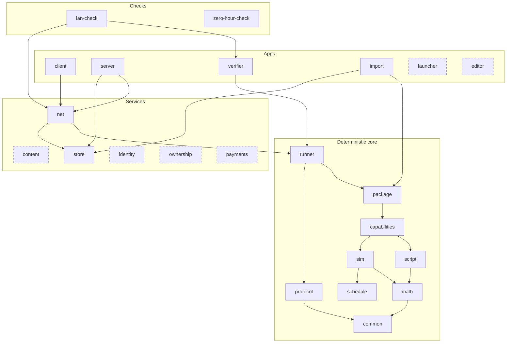

# Campfire — Engine Core

## Module map

Dashed: planned. `log` is left out: the binaries, `net`, `runner` and `verifier` use it. `codec` is left out too: every crate that serializes uses it. Each layer uses the layers below it.

## Modules

| Module | Status | Does |
| --- | --- | --- |
| `common` | built | The vocabulary of crates that do not depend on each other: the player slot, ticks, segment seed, 32-byte hex values, a package's fingerprint, the TLS key a server presents and a TLS session's channel binding, exit statuses; behind `internals`, the allocation audit of each crate's `tests/alloc` |
| `codec` | built | The one gateway of serialization, a proxy crate: postcard, TOML and JSON, each with one configuration, one canonical form and one error type ([Serialization](#serialization)) |
| `schedule` | built | The build settings of the sim's schedules, a proxy crate: a schedule that fails on ambiguity and redundant edges, and the probes' variant with no sync points |
| `math` | built | Fixed-point numbers, 3D vectors, exact ground-plane vectors, trig, integer roots, directions, counter-based RNG, SIMD lanes, each operation one `i128` step rounded once ([Determinism core](09-determinism-core.md), D8) |
| `protocol` | built | Signatures, session key delegations, the handshake, input chains, the seed chain and the session log, with no IO ([Protocol Spec](05-protocol-spec.md)) |
| `sim` | built | Deterministic state and systems on `bevy_ecs`; no genre code |
| `script` | built | The script runtime: the Rhai host, which compiles scripts and runs each call under its limits; the script API's registry, `ctx`, the call's frame, the batch, script state, and the script view the modules fill ([The core's crates](#the-cores-crates), [Script API](08-script-api.md)) |
| `capabilities` | built | Mechanisms a mode combines: the top of the capabilities' crates, a crate each ([The capabilities' crates](#the-capabilities-crates)): `release`, which installs them, the books, `Match`, the senders' `Order`, and the published surface ([Capabilities](04-capabilities/00-overview.md)) |
| `values` | built | Data value types: numbers, per-rank values, params, filters, package paths, names and ids ([The capabilities' crates](#the-capabilities-crates)) |
| `geometry` | built | Exact geometry in `Num`: the map's metric and bounds, shapes and boxes of bodies, polygons, the grid ([The capabilities' crates](#the-capabilities-crates)) |
| `state-types` | built | The state types each module declares, and how each is sent ([The capabilities' crates](#the-capabilities-crates)) |
| `visibility` | built | Who receives each kind of state: the mode's and the host's visibility settings ([The capabilities' crates](#the-capabilities-crates)) |
| `declare` | built | How a module declares what it adds to a match, and what its install reads ([The core's crates](#the-cores-crates)) |
| `units` | built | The units: their model, books, systems and script API, and the read of the script view ([The core's crates](#the-cores-crates)) |
| `players` | built | The match's and the players' entities, their resources and commands, and their part of a call ([The core's crates](#the-cores-crates)) |
| `stats` | built | The `stats` capability: stats, pools, modifiers and grants ([The capabilities' crates](#the-capabilities-crates)) |
| `actions` | built | The action pipeline and the action slots, under every capability that acts ([The capabilities' crates](#the-capabilities-crates)) |
| `deliveries` | built | The deliveries of actions and their hooks ([The capabilities' crates](#the-capabilities-crates)) |
| `combat` | built | The `combat` capability ([The capabilities' crates](#the-capabilities-crates)) |
| `navigation` | built | The `navigation` capability ([The capabilities' crates](#the-capabilities-crates)) |
| `vision` | built | The `vision` capability ([The capabilities' crates](#the-capabilities-crates)) |
| `projectiles` | built | The `projectiles` capability ([The capabilities' crates](#the-capabilities-crates)) |
| `areas` | built | The `areas` capability ([The capabilities' crates](#the-capabilities-crates)) |
| `abilities` | built | The `abilities` capability ([The capabilities' crates](#the-capabilities-crates)) |
| `progression` | built | The `progression` capability ([The capabilities' crates](#the-capabilities-crates)) |
| `production` | built | The `production` capability ([The capabilities' crates](#the-capabilities-crates)) |
| `interaction` | built | The `interaction` capability ([The capabilities' crates](#the-capabilities-crates)) |
| `items` | built | The `items` capability ([The capabilities' crates](#the-capabilities-crates)) |
| `orders` | built | The `orders` capability ([The capabilities' crates](#the-capabilities-crates)) |
| `mode` | built | The mode: its script, state, choices and spawns, on the capabilities below it ([The capabilities' crates](#the-capabilities-crates)) |
| `package` | built | A mode's packages and their dependencies, from the bytes a `PackageSource` gives, each file on demand and checked against its index, and the load checks; part of the deterministic core, it reads no file itself |
| `client-files` | built | The client's data files of a package, which the sim never reads: its camera, its unit types' and its maps' looks, its materials, its maps' lights, terrain and ground heights, and the texture levels the terrain draws; only `import`, which writes them, and `client`, which draws them, depend on it |
| `package-disk` | built | A package's directory on disk as a `PackageSource`, the store of packages by fingerprint a verifier holds, and the writer of a package and its index, all through `store`; the workspace's test packages behind `internals` |
| `runner` | built | Builds a match from checked packages and feeds it inputs; replays a published log, checking its checkpoints and its result, for the verifier and the tests; owns `SessionRules`, which builds a session's terms and checks them on the server, the client and the verifier |
| `verifier` | built | CLI: replays a session log segment and checks the result |
| `lan-check` | built | The real server and bot clients over QUIC on `127.0.0.1`, on request ([Testing and diagnostics](#testing-and-diagnostics)) |
| `zero-hour-check` | built | Imports the Zero Hour install `GENERALSZH_DATA` names and checks it, on request |
| `harness` | built | The match harness of the session's and the network's tests, fixed and scripted sessions, goldens, records and the in-process match, and those tests and benches: their top test crate, never shipped ([Testing and diagnostics](#testing-and-diagnostics)) |
| `server` | built | The dedicated server's headless binary: its host config from the command line, logging, socket, port map and exit; `net` hosts its session |
| `net` | built | Lightyear over `quic`: handshake, replication; and the session host the dedicated server, the client's local server on a thread and the test harness share: lifecycle, lobby, saves, journal and checkpoints; internal ([Networking](#networking)) |
| `quic` | built | QUIC alone under Lightyear's link: an endpoint on a thread of its own, the server's raw TLS key and the client's pin, and the server's port mapping; no game ([QUIC transport](15-quic-transport.md)) |
| `log` | built | Log output: text on standard error and JSON lines into a file; the events a tool reads back; the end of a command line |
| `store` | built | Durable and secret files, data directories and their locks, and worker threads, a proxy crate ([Storage](#storage)); the platform layer, which also catches the stop's signals ([Platform](#platform)) |
| `launcher` | planned | Fetches, checks and starts the engine release a server or replay names; server browser |
| `client` | built | Bevy app: rendering, input, UI, audio, prediction, presentation systems ([Zero Hour](12-zero-hour.md#the-client)) |
| `import` | built | Reads a game's install through `store` and writes one reproducible package, a module for each game ([Zero Hour](12-zero-hour.md#the-importer)) |
| `content` | planned | Package signatures, pinning, cache, Blossom fetch |
| `editor` | planned | Map and content editors |
| `identity` | planned | Nostr keys, session keys, listings, reputation |
| `ownership` | planned | License checks (optional) |
| `payments` | planned | Pools, hold invoices, wallet budgets (optional, separate repo) |

A module is built when the workspace has its crate, `campfire-<module>`, in a folder of its module's name: `source/checks/` holds the checks, and `source/crates/` the rest, in a group for each role, `base/` (`common`, `codec`, `log`, `schedule`, `store`), `sim/` (`math`, `sim`), `capabilities/` (`campfire-capabilities` itself, beside its `core/` and the capabilities' crates), `session/` (`protocol`, `package`, `package-disk`, `client-files`, `runner`, `verifier`), `network/` (`quic`, `net`), `apps/` (`server`, `client`, `import`) and `test/` (`harness`); a test fails when this column and the workspace differ, and another when a crate's folder is not its package's name without `campfire-`. `lan-check` and `zero-hour-check` live in `source/checks/`, and nothing depends on them, nor on `harness`.

`sim` is pure: state and inputs in, next state out; no files, packages or signatures.

**Dependencies.** `server` and `client` → `net` → `runner` → `package` → `capabilities` → `script`, `sim` → `math` → `common`; `sim` → `schedule`; `runner` → `protocol` → `common`; `net` → `quic` → `common`, `store`, `log`; every crate that serializes → `codec`; `verifier` → `runner`; `package-disk` → `package`, `store`; `server`, `client`, `import`, `verifier` → `package-disk`; `import`, `client` → `client-files` → `sim`. `server`, `client`, `net`, `package-disk`, `verifier` and `lan-check` use `store`; `harness` uses every crate below it, with its `internals`; `zero-hour-check` uses `import`, `package-disk`, `store` and `harness`. `runner` and `net` take `package-disk` only under their `internals`, for their tests' packages. No crate of the deterministic core depends on `store`, and `store` depends on no engine crate. `log` depends on `common`, and on `store` only under its `start` feature, which only the binaries turn on. A type enters `common` only when two crates that do not depend on each other both name it, as a plain value: construction, parsing, display and serde, and no other logic. `common` depends on `serde` and `derive_more` alone, and, for the allocation audit behind `internals`, `backtrace`.

### The capabilities' crates

Each module is a crate, as Bevy's are, so each import between modules is a dependency that Cargo checks: an import against the graph does not build. A capability's dependency on another is a need, without which it does not run, or a use, which it reads when the match has it, as `Module::NEEDS` and `Module::USES` declare them: a release test holds each capability crate's dependencies on other capabilities equal to the two, and `LAYERS` holds each crate's layer.

| Layer | Crate | Folder | Needs | Uses |
| --- | --- | --- | --- | --- |
| 0 | `campfire-state-types` | `capabilities/core/state-types` | — | — |
| 1 | `campfire-values` | `capabilities/core/values` | — | — |
| 1 | `campfire-visibility` | `capabilities/core/visibility` | — | — |
| 2 | `campfire-geometry` | `capabilities/core/geometry` | — | — |
| 3 | `campfire-script` | `capabilities/core/script` | — | — |
| 4 | `campfire-declare` | `capabilities/core/declare` | — | — |
| 5 | `campfire-units` | `capabilities/core/units` | — | — |
| 6 | `campfire-players` | `capabilities/core/players` | — | — |
| 7 | `campfire-stats` | `capabilities/stats` | — | — |
| 8 | `campfire-actions` | `capabilities/core/actions` | — | — |
| 9 | `campfire-combat` | `capabilities/combat` | stats | — |
| 9 | `campfire-deliveries` | `capabilities/core/deliveries` | — | — |
| 9 | `campfire-interaction` | `capabilities/interaction` | — | — |
| 9 | `campfire-items` | `capabilities/items` | stats | — |
| 9 | `campfire-progression` | `capabilities/progression` | stats | — |
| 10 | `campfire-abilities` | `capabilities/abilities` | stats | — |
| 10 | `campfire-areas` | `capabilities/areas` | stats | — |
| 10 | `campfire-navigation` | `capabilities/navigation` | — | — |
| 10 | `campfire-projectiles` | `capabilities/projectiles` | stats | — |
| 10 | `campfire-vision` | `capabilities/vision` | — | — |
| 11 | `campfire-production` | `capabilities/production` | — | navigation, stats, vision |
| 12 | `campfire-mode` | `capabilities/mode` | — | combat, items, navigation, production, progression, stats, vision |
| 12 | `campfire-orders` | `capabilities/orders` | navigation, stats | interaction, production, vision |
| 13 | `campfire-capabilities` | `capabilities` | — | — |

- **The senders' `Order`.** `Order` and its `Action`, a sum of each owner's action, live in the top crate, so `orders` depends on neither `items` nor `progression`. `orders` keeps its dependency on `production`, whose build and gather orders a unit takes, on `interaction`, whose use slot a use order fills, and on `vision`, whose sight it reads.
- **Contracts.** A capability asks another for its work through a part of `units` that both read, never by writing the other's state, as 0 A.D.'s components ask a walk of `UnitMotion` through its interface. Each such part is the state or the report of the capability that pursues it, kept in `units` so the capabilities that ask need no dependency on it: `Dead`, `ForcedMove`, and a walk's `Destination` with `ArrivedShort`, which navigation pursues and answers ([Navigation](04-capabilities/navigation.md), Walking a route). So `abilities`, which walks a caster into range, depends on no navigation.
- **Visibility.** An item that another crate uses becomes `pub`; the rest stays `pub(crate)`. A crate's published surface is its `lib.rs`, which names only the crate's own items: `net`, `runner`, `client` and the rest depend on the home crate of each type they name.
- **Tests.** A test that builds a whole `Match` lives in the top crate's `tests/`, one binary, in a module for each capability crate and for each of the core's crates: `release` composes the match there, and every crate it tests is a dependency of that crate. A test of a crate's own types, with no `Match`, stays a unit test in its crate. So no crate has a dev-dependency on a crate above it, and no test build holds a second copy of a crate, whose types would not be the match's. A test helper that another crate's tests use is behind `internals`, and one that needs a higher crate is a method of an extension trait in the top crate's `internals`. The tests that play a session or a network match live alike in the top crate of their own, `harness`, which holds the match harness and every crate those tests read. A crate's dev-dependencies are itself with `internals`, the test infrastructure of a base crate, `store`'s scratch and pinned files, `log`'s `LogCheck`, `common`'s allocation audit and `codec` for a type's encoded form, `math` for the numbers a crate's values hold, and outside test tools; a binary, which cannot dev-depend on itself, dev-depends on the dependencies whose helpers its tests read. `common`'s test of the feature refuses any other. `harness` is all test code, its benches included, so it has no `internals` of its own and no dev-dependency: it depends, with their `internals`, on every crate its tests read.
- **Dependencies.** A crate's `internals` turns on `internals` in each of its dependencies that has the feature, so its self dev-dependency gives its tests every dependency's `internals`. Its other dev-dependencies are only tools its tests use that are not its dependencies: `campfire-codec` for a unit test of a type's encoded form, as every format goes through it, and `campfire-store`, with its `internals`, for the files a test reads.
- **Checks.** Each crate carries the lint list and the `internals` self dev-dependency, and the drive's lanes cover it. Cargo refuses a cycle, but not a dependency on the same layer or a higher one whose crate does not depend back: `LAYERS` lists each capability crate with its layer, and a test reads each crate's manifest and fails on a dependency that is not on a lower layer. A crate's layer is one above the highest of the crates it depends on and the capabilities it needs, so no two crates of one layer depend on each other. The test that no module names another's sets reads every capability crate.

### The core's crates

The core under every capability is four crates, each on a layer of its own: `campfire-script`, `campfire-declare`, `campfire-units` and `campfire-players`. Each imports only the crates before it, so Cargo holds their order. The script view is the script runtime's own data, which the modules fill, and the unit model stays in `units`, so `units` depends on the runtime and never the other way.

- **`values`: the plain types and ids:** the ids, the sets of tags and teams, the tag properties and the engine tags, and the components the view's row holds, `Team`, `UnitType`, `UnitTags` and `Relations`. Each is a `SimComponent` whose host is `OnAny`; `units` declares its host and its checks against the books, as it does for `sim`'s `Position`. A method that reads a book is the book's.
- **`campfire-script`: the runtime and its view.** The Rhai host and the scripts' runtime are one crate, the one that names Rhai. The view holds plain values and names no part of a unit: the core row of each unit, the relations, the metric and the bounds as the running stage read them, one table of names for each kind of id, and the columns the modules add, each through the contracts of a column, which give how it keeps, counts and compares its rows. `units` gives the function that reads a world's units into the rows as it opens a match.
- **`geometry` holds `BodyGrid`,** the grid of bodies that both the view's target index and `units`' `UnitGrid` search.
- **`campfire-declare`: the contracts alone:** how a module declares what it adds, its kinds of entity and their parts, and the traits of books, read through the world it is given.
- **`campfire-units`** holds the unit model, its books, its systems and its script API, and fills the view's rows ([Scripting](#scripting)).
- **`campfire-players`** gives a call its copy of the players' resources, a part of every call, so the call's frame names no player.

**Game-bound code.** Code that serves one imported game lives in a module named after it, in the crate whose interface it serves: Zero Hour's importer in `import::zero_hour`, its backends in `navigation::zero_hour`, its AI in the `zero_hour` module of the crate that drives server bots. Nothing depends on it but the place that installs it; a mechanism a second game needs moves into a general module. The presentation has no game-bound code: the client draws every game by one rendering pipeline, one material and lighting model, Bevy's physically based standard material, and the generic formats it reads, glTF and the client files. An importer converts its game's materials, lights and formats to them, as near the original as it can, writing down what it loses ([Zero Hour](12-zero-hour.md#decisions), D13); where a game needs what the pipeline cannot say, the pipeline gains a general feature any game may use, never a path for one game.

Outside the engine crates: the MOBA test content, the rules packages and bots. Only the tests of `harness` and `runner`, and `lan-check`, use the MOBA and the bots. Bots produce inputs like players, so replays never depend on bot code.

## Structural rules

Each rule has a test that fails when it breaks, as a rule only a review checks drifts again.

| Rule | Enforced by |
| --- | --- |
| One owner for each fact: a package fact in one immutable book, a match fact in state, a call's fact in its frame. Nothing else holds a copy. | The declaration audit; the behaviour golden |
| Each module, the core's and each capability's, declares once all it adds to a match but its systems: its state types, kinds, parts and pairs, restore checks, resources by what they are (state, scratch, cache or report), the registries of callbacks it calls and the callbacks it gives them, books, script view columns, call parts and those that hold a scope's params, the parts each kind of entity spawns with, the match's, a player's and a unit's, each with its restore check, the parts a server's match derives, which an entity spawns with by Bevy's required component, its observers, the systems it runs out of the schedule, Bevy's one-shot systems, each with the resource that keeps its id, its system sets, each with its phase or its gap, and script API. Every consumer reads that one list: the install, the script API's binding, the network layer's lists and the declaration audit. An install asks the declared capabilities and the match's role, a server's or a client's, what the match has, never another module's resources, and holds only its systems: each sits in one set of its own module, and orders within its set by chaining, or, one that only some matches build, by `before` or `after` a system of its set that every match of its module builds. A system that computes the server's own state goes through `InstallCx::server`, which puts it in `ServerOnly` too and which a client's install leaves out. A fact the install or the load fixes is a fact of the schedule: a system the role or a capability rules out is not added, one that a mode's hook or book rules out runs under a run condition, and one that needs a structure the map may lack, as the pathing grid, takes it by Bevy's `If`, which skips the system while it is missing. A set's order is its phase's: `declare` holds the tick's phases in one list, `Phase::ALL`, whose phases of one stage run in that order, as Avian chains its physics step's sets in one place; the sets of one phase run in the order the schedule picks, so two that conflict sit in two phases, and no module names another's sets. | `Declarations` has no default method; `ModuleSet` has no default method; the declaration audit test, which refuses a set declared twice or by another module, and lists each observer, run and server part; the release test that no module's code names another module's set; the strict schedule's ambiguity check, with and without sync points, which fails on two sets of one phase that conflict; the proving match's test that each game system sits in a declared set; `Release::unlisted_resources`, which the proving match runs after each tick; the install of the books, a walk of the declarations, which refuses a book declared and not built, built and not declared, or put where its owner is not installed |
| A name becomes an id where it enters. After the load no system looks up a name; a script call resolves its name once, with no allocation. Every lookup of an id by name is a method ending in `named`. The book builder that resolves a name is its check: it returns the name the match does not have, and the load check looks a name up only where a rule of its own reads it. | The book builder's tests; the allowlist test of name lookups; the flaw tests of the package load |
| A rule of a package's data has one home, the function that tests it, and the book builder that holds the data returns the rule's case: untrusted data never reaches a builder's `expect`. The load check maps each case to its problem, and calls a rule's function itself only where another of its checks reads what the function gives, as the slotted ranks and an action's kind fields. | The flaw tests of the package load; the ability load test |
| The load refuses everything a match can refuse. A match start fails only on its terms (players, tick rate, seed, the packages they name) and on `on_match_start`'s runtime failure. | `StartError` has no case of a package's data |
| A layer calls a higher one only through a hook the higher one registers: a column of the script view, a part of a call's frame, an effect type, an entry of the release's module list. | Cargo, as a crate builds only on its dependencies; the layer test, which reads each capability crate's manifest and refuses a dependency that is not on a lower layer |
| No crate re-exports another crate, whole or in part: a crate that names a type depends on its home crate, at the version the workspace pins, and a type its callers must not take from its home crate is its own, as `campfire-codec`'s `TomlError` and `JsonError`. | `no_crate_re_exports_another_crate` |
| Every order that matters is by stable id, and every rounding uses one helper. A system that spends something shared, takes ids or runs scripts walks its units through `Ordered`, sorted by stable id, as a query gives archetype order, which a component added or a restore changes. | The archetype-shuffle test |
| Each tick's work has a fixed limit or a cost in proportion to the units that take part: no tick pays for a scan or a rebuild the others do not. | The work record; the navigation bench |
| Restored state is checked like package data: every flaw is an error, never a panic, and what it accepts plays on. Times and counts stay within what a match makes: at most 2⁶², so no sum of two overflows; every period at least a tick; and every relation a system takes between restored values, or with the books, holds. | `Tick` and `Ticks` decodes refuse past 2⁶²; every state type's required check; the snapshot fuzz, which flips each byte of a proving match's snapshot and plays five ticks on what restores; the structured fuzz of every decodable value; the mutation fuzz, which removes, moves and copies each state type's value; restore tests at each type's limits |
| Each rule of a network session has one owner on each side, and a client that follows the rules is never refused. | The net scenarios under load |
| A function that acts on a match has one home, by what it acts on. The whole match, its ticks, its state, its schedule and its session, and the fast access to one module's singleton or index, are methods of a trait on `World`, so a test's `Match` and an `App`'s world read the same: each module owns its traits in `<module>_world.rs`, `<Module>World` for other crates, `<Module>WorldCrate` for its own crate and `<Module>WorldInternals` for the tests and benches of any crate. A world method knows no fixture, and acts on every match. The match's content, what a module loads, spawns, gives, queues or finds by name, is an associated function of the module's type, its capability type where it has one, the world its first parameter: `Actions::load(world, …)`, `Combat::queue_damage(world, …)`, `Players::spawn_match(world, teams)`. A value or a view made from the world is a constructor of its own type, `StateCopy::of(world)`, `PoolMeters::of(world, entity)`; a match in a world of its own is an associated function of the type of the module that builds it, which returns the `Match`, `Session::start_match`, `MatchBuild::arena`. No `pub` or `pub(crate)` free function takes the world, but a system, an observer, a hook or a run condition, which Bevy registers by value, and a function a table holds. A test fixture is a struct of the ids it places into a match, `Carrier::place(&mut game)`, whose verbs take the match, so fixtures share one match and work in any match of their capabilities. | The world rule test of `common`, which scans every source file |
| `common` depends on no crate but those its row above names. | The manifest test of `common` |
| A crate's required dependency is one its production code names; one that only code a gate holds uses is optional, and `internals` turns it on. | `a_required_dependency_is_named_by_production_code` of `common` |
| No sibling modules of a crate import each other in a cycle, at any level of its module tree, as Cargo refuses a cycle between crates: under each module that has children, the crate's root among them, the graph of its children, from the `crate::` paths of their production code, a group's each path its own, has no strongly connected component of more than one module. Two types that are one table in two parts, as `Modifiers` and `ModifierClocks` or `ActionSlots` and `SlotTimes`, or a check that only one type's build runs, as `LoadCheck` of `ModePackages`, share a module, the one a child of the other. A view column or a call part takes its book from the match as it begins, and a book names its ids to scripts in the view's tables by their type, so no book imports the column or the part that reads it. | `no_crates_modules_import_each_other_in_a_cycle` of `common` |
| A banned call goes through its proxy crate: files and threads through `store` ([Storage](#storage)), the formats through `codec` ([Serialization](#serialization)), a schedule's build settings through `schedule`. A proxy exempts the lints at its crate root alone, depends on its listed crates alone and names no other group's call; a ban with no proxy is exempt nowhere, but the ban of `thread_local!`: a module whose state an outside API keeps per thread, as a global allocator or tracing's default subscriber does, exempts the types' lint at its head and names no other banned type. When a proxy lacks what a caller needs, the proxy gains it. | `disallowed-methods` and `disallowed-types` in `clippy.toml`, grouped by owner, and the tests of `common` that check each group, each exemption, each proxy's dependencies and each proxy's names |
| Code that differs by OS lives only in `store`'s `platform` module ([Platform](#platform)). | The platform rule test of `common`, which scans every source file |

**Inputs and collections.** A function that takes a sequence takes `impl IntoIterator`, and collects it where it keeps it, which reuses a `Vec`'s buffer; it keeps a concrete type when it is a `const fn`, keeps a byte buffer, depends on a map's order or uniqueness, or runs on a hot path, which takes a slice or a scratch buffer. A collection type that a caller builds from a sequence implements `FromIterator` as its one constructor, and `From<[T; N]>` and `Extend` from it, as `Vec` and `BTreeMap` do; `From<Vec<T>>` only where serde reads through it. A constructor whose input holds a contract beyond its items keeps its name, as `ActionSlots::new`, whose slots come kind after kind, and `PoolCost::new`, which names each pool once. `impl Into<T>` stands only for a fixed type with several natural forms, as `Position`, never on a function generic over the type it converts to, whose caller would then name it: `world.insert_resource(UnitStateBook::from([schema]))`, not a generic `insert_resource`. `clippy::needless_collect` finds a collection made only to pass on; review holds the rest, as no lint finds a `Vec` a function keeps.

**Books.** One pure function of a match's packages and a tick rate, with no world, builds its books: unit types and tags, tracks, modifiers, actions with their params and effect lists, AIs, projectile and area specs. The load calls it at the fastest rate the manifest allows, where a time counts the most ticks, so what the books cannot hold fails the load; a match calls it at its own rate. Ids follow the builder's order: tags, tracks, every package's modifiers, then each package's actions and unit types, the mode's first. A script is named by its place in the order a match compiles them, and its hooks come from what the load read, so no book needs a script host.

## Capabilities

The core has no genre code; a mode combines capabilities: [Capabilities](04-capabilities/00-overview.md).

## Lifecycle and sessions

- Engine states: **waiting** (players connect, packages load, start gates pass) → **running** → **ended** (result or aborted; the log is sealed, end hooks run). Everything inside running (pick, rounds, overtime) is the mode script's; `ctx.end` is optional, and a persistent world never calls it.
- Start gates and end hooks are how optional modules join the lifecycle: `payments` adds a gate that locks stakes and a hook that settles them; the engine holds no money code.
- A session outlives its process, its links and its players ([Sessions](10-sessions.md)): a match restores by replaying its log from its latest checkpoint; players reconnect with the same main key. The server logs each input before its tick runs and syncs the log from a background thread, so no tick waits on the disk.
- The restore window must end before any stake's hold invoice expires; a window of 0 means a crash always aborts.
- Script state is versioned; migration hooks convert saved state when a package version changes at restart.

## Inputs

Anything from outside enters the sim as a recorded input: player commands, bot inputs, connects and disconnects, carry loads, admin commands, payment events, calendar time. What is not in the log, the sim cannot depend on. A client may join a running game at any time and receives the current state of what it may see.

## Session log

- A match with no save is one segment; a world checkpoints every few minutes, and every save is a checkpoint. The verifier replays any segment from its checkpoint; hosts set how long logs are kept. Format: [Protocol Spec](05-protocol-spec.md#session-log).
- **Snapshot:** the postcard encoding of every state component and resource, entities by stable id, types in an order the release fixes. Its format belongs to the engine release, not the protocol, and carries `StateRegistry::DATA_VERSION`, a little-endian `u32` after its tag, raised whenever the format changes, a type's layout included, as Minecraft's `DataVersion` is; a restore refuses another version with `SnapshotError::OtherVersion` before it reads a type. A test pins each type's layout fingerprint with the version, in `harness`'s `tests/golden/layout.txt`, so a layout that changes at the same version fails by name; `CAMPFIRE_BLESS=1` writes the file again only for another version.
- **State hash:** one BLAKE3 hash for each state type over the snapshot's bytes, then one over the list of `(name, type hash)` ([Determinism Core](09-determinism-core.md)). The goldens compare it every tick on every OS, and at a mismatch the per-type hashes name the first divergence.
- **No slow tick for a checkpoint:** at the boundary the server copies only the components changed since the last checkpoint, and a background thread applies them to its copy, encodes, hashes and writes it ([Checkpoints](10-sessions.md#checkpoints)).

## Saves

A save is a checkpoint a player keeps: the snapshot at a tick boundary and the log before it, written as every checkpoint is. When it is due, and loads, are [Saves and loads](10-sessions.md#saves-and-loads).

- **Converters.** A save loads on its release and every later one. Each release carries a converter from the data version before it, one way, as Factorio's map versions and Minecraft's DataFixerUpper do; an older save runs them in order. A release may drop old converters, and the launcher then fetches the last release that had them to convert in two steps. Script state converts by the packages' `state_version` and migration hooks.
- **Verification.** A segment verifies on the release that recorded it. A converted save starts a new segment, whose checkpoint the converter made outside the sim; the log names both releases, and the proof of the earlier segment ends at the conversion.
- **Carry.** The mode declares a carry schema, typed and versioned like script state. `ctx.carry` reads the carry the session loaded and writes the one it hands on; the server writes it at the session's end and with each save. A session loads a carry as an external input at its start, so its log holds everything it read.

## Storage

`store` owns how files are read, listed, checked and written and how threads run; the crate that defines a file's bytes owns what they hold. One layer gives each read and write one place to keep its promises: a bound on what it reads, a refusal of a link, a durable write, and an error of cases for each failure.

- **Durable files.** `DurableFile` writes a temporary file, syncs it, renames it over the target and syncs the directory; each step's failure is its own error, never retried ([D9](10-sessions.md#decisions)). `DurableDir` makes and removes directories the same way, each made its owner's only, its parent synced after, with its own error enum: `create` one when missing, `create_all` each missing one above a path, as a data directory is made, `create_new` one only where nothing holds its name, and `remove` one with all it holds.
- **Secret files.** `SecretFile` is a durable, owner-only file: the server's key, from which its TLS key derives, a client's `--key`. It is made from a path where the path enters and gives no `&Path` back, so code that holds a secret cannot pass it to `fs::read`.
  - **Read** opens the file, following a link as OpenSSH does, and checks the open handle; it refuses, each as its own case, a missing file, one that is not regular, one others may open, and one longer than its caller's bound, read no further than one byte past it.
  - **Create** writes a new secret and never replaces one: its bytes take the secret's name only if no file holds it, so of two processes that make one key at once, one makes it and the other reads it.
  - **Replace** writes as `DurableFile` does, for a secret renewed under its data directory's lock.
  - **Zeroed.** The bytes a read gives and a caller encodes are `Zeroizing` buffers, which overwrite their memory when dropped, allocated once at the caller's bound plus one byte, so no growth leaves a copy. A decoded key stays in memory while the process runs.
- **`protocol` does no IO.** The session log writes framed records into a `RecordSink` and takes the durable count from its caller; `net`'s `SessionJournal` implements it over `store`'s `AppendWriter`.
- **Workers.** Every thread starts through `store`'s `Worker`: named, closed when its handle drops, and joined; a handle dropped during a panic does not join, so a crash ends the process at once. One thread per job: `AppendWriter` (a stream with grouped syncs and a durable count), `StreamWriter` (no sync, a bounded buffer that makes its caller wait), `Exchange` (one job in flight) and `LatestWriter` (the newest value only). None waits for the disk or allocates in a steady state. They share one lock of their state, which a caller's code that panics as it holds the state poisons: the next lock of the worker or the owner then panics, and only the owner's drop closes over it, as a second panic during an unwind aborts. A writer that stops at a failure keeps it for its owner to take once; a worker that panicked passes its panic on to the call that next needs it, or to its handle's drop.
- **Data directories.** `DataDir` exists only while it holds its directory's lock, so a second process on one directory is refused, and gives every path in it from typed ids; its layouts are `ServerLayout` and `ClientLayout`, which a tool reading a finished run's directory uses with no lock. A directory others may open is refused, as Tor refuses its `DataDirectory`.
- **Reads.** `InputFile` reads a file never past a bound its format's owner derives from that format's limits: whole, as text, in pieces, as a package reads a file no further than its index row, or by ranges from one handle with the file's stamp, its length and time of change, by which a reader that opens it again knows it is the same file, as `make` does. A read checks the path's kind before it opens, as an open of a pipe waits for a writer, and the handle's after, and reads at most one byte past the bound, so a growing file is refused. Its error is an enum of each way a read fails, a missing file among them, and every error of `store` names its path, so a caller wraps none.
- **Listings.** `DirEntries::read` gives a directory's entries sorted by name, each with its kind, a link not followed; a missing directory is `Missing`. No call asks whether a path exists: a caller lists once, so every name's answer comes from one moment.
- **Child output.** `OutputFile::stdio` makes a new owner-only file as a child process's `Stdio`, so no `File` leaves `store`.
- **Scratch.** A test's files live in `store`'s internals' `Scratch`: an owner-only temporary directory, removed when it drops, which makes, reads, lists, renames, links, exposes and removes files by paths within it, panicking with the path on a failure. A test reads the workspace's sources through `SourceFiles`, and races two writers through `Race`.
- **Faults.** A worker's failure is an enum of the step that failed; `store` decides no policy. `net`'s `Faults` ends the server with exit code 74 on a journal or snapshot failure, and logs a failed receipt and a sync slower than a second.
- **Enforced.** `source/clippy.toml` bans, under `disallowed-types`, every type that holds a file, and under `disallowed-methods` `std::fs`'s free functions, `Path`'s probes, `tempfile`'s functions and the thread starts. Only `store`'s crate root `expect`s both lints ([Structural rules](#structural-rules)); a test of `common` refuses any other `expect` or `allow` of either but the other proxies' roots. Bevy's asset server reads through a package asset source over `package`'s reader, which `package-disk` gives ([Zero Hour](12-zero-hour.md#the-client)).

## Serialization

Every serde encoding and decoding passes through the proxy crate `codec`, as every file passes through `store`: one configuration, one canonical form and one error type for each format.

- **Formats.** Postcard 1.x for every binary encoding: the protocol's records, the log, the journal, snapshots and the state hash, commands, the package index, a package's binary files. TOML for data files and configuration a person writes. JSON for logged events, reading log lines back, and glTF's JSON. No other serde format.
- **One encoding.** Postcard's decoder takes an over-long integer and ignores trailing bytes, so the gateway's decode encodes what it read again into a comparing output that allocates nothing: a decode on a hot path costs a second pass and no allocation. A whole value refuses any byte past it. A format's own order rules, as a snapshot's entities by stable id, stay with the format's owner.
- **Sinks.** An encode appends to a `Vec` its caller keeps, or writes into a `Sink` in batches of 64 bytes, so no encode on a hot path allocates.
- **Errors.** A postcard decode fails with `BinaryError`: bytes that end inside the value, bytes of no value of its type, or another encoding of a value. A TOML or JSON parse fails with its crate's error, with line and column.
- **Network.** Every message registers through `register_message_custom_serde`, and every component through `replicate_with` or `replicate_once_with`, with the gateway's encode and decode, at the `lightyear_serde` version Lightyear builds.
- **Outside the gateway.** Layouts a specification fixes byte by byte stay with their owner, by hand: the files the importer reads or writes (`.big`, map chunks, W3D, DDS, KTX2, GLB) and the protocol's signed messages and frames. One engine layout stays hand-built: the golden harness's digest of a tick.
- **Enforced.** `source/clippy.toml` bans, outside `codec`, each format crate's entry points and replicon's postcard helpers, and everywhere Lightyear's registrations that take its own encoding; each format's `Serializer` and `Deserializer` are banned as types. `str::parse` into a `toml::Table` or `serde_json::Value`, and a struct built by its path with no `use`, stay open, as clippy cannot ban them; no code takes either. `common`'s tests check the lists ([Structural rules](#structural-rules)).

## Platform

One promise on every OS. Code that differs by OS lives only in `store`'s `platform` module, `platform/unix.rs` and `platform/windows.rs`, behind one interface: no other code names an OS (`cfg` of `unix`, `windows`, `target_os`, `target_family`, or `std::os`). A promise one OS cannot keep is narrowed for every OS.

- **`OwnerOnly`** makes a file or directory only the current user may open, and checks that a file is so. On Unix, mode 0600 or 0700, given as it is made; a file is owner-only when its owner is the effective user or root and its mode grants others nothing. On Windows, a protected DACL with one entry for the token's user; a file is owner-only when its owner and each allowing entry name that user, SYSTEM, Administrators or TrustedInstaller, as OpenSSH for Windows checks a key, and a file with no DACL is open to all. The check reads the open handle. Who else may open a file comes back as human text: `mode 640` on Unix, account names on Windows.
- **`DurableName`** gives a file its name, replacing the file of that name, so the name survives a crash: a rename then a directory sync on Unix; `MoveFileExW` with `MOVEFILE_REPLACE_EXISTING` and `MOVEFILE_WRITE_THROUGH` on Windows. It syncs a directory that changed: `fsync` on Unix, `FlushFileBuffers` on a directory handle opened with `FILE_FLAG_BACKUP_SEMANTICS` on Windows. A failed rename is never retried ([D9](10-sessions.md#decisions)). It also names a file only where no file holds the name: `link` then `unlink` on Unix, `MoveFileExW` without `MOVEFILE_REPLACE_EXISTING` on Windows.
- **`StopSignals`** catches the signals that stop a process by its exit, for the rest of the process: the first raises a flag the app reads each frame, and a second ends the process at once with code 130. On Unix, `SIGINT`, `SIGTERM` and `SIGHUP`, each only when the process did not start with it ignored, which `sigaction` reads; `signal-hook` catches each, with a handler that only sets the flag or calls `_exit`, as POSIX lets a signal's handler. On Windows, the console's Ctrl-C, Ctrl-Break, close, logoff and shutdown, through `SetConsoleCtrlHandler`, whose handler runs on a thread of its own: Windows ends the process once the handler of a close, logoff or shutdown returns, so that handler waits for the process's exit, within the 5 s Windows gives, as .NET's `PosixSignalRegistration` does; a process started in a process group of its own takes no Ctrl-C, as Windows has it.
- **`SharedPort`** binds a UDP socket to a port that the host's other sockets bind too, as each SSDP listener of a host binds port 1900, each taking the multicast datagrams sent to it ([QUIC transport](15-quic-transport.md), D12): `SO_REUSEADDR` and `SO_REUSEPORT` on Unix, as BSD and macOS bind a port twice only with the second, through `socket2`; `SO_REUSEADDR` on Windows. A socket bound without it keeps its port its own on every OS.
- **Test helpers** in `store`'s internals expose a file to other users, make a link, check a path, and start a child with the terminal's signals ignored and stop it, so a test of a promise runs on every OS with no `cfg`.
- **Unsafe code.** `unsafe` is only where an outside API asks for it, or a path a bench shows faster needs an instruction Rust reaches only through a library call. The module holds Win32 through Microsoft's `windows` crate, and `libc` on Unix. Each block says why it is sound.
- **The same result on every OS** where no code differs: a package path names only a file every OS holds as the same ([Package paths](03-game-scripting.md#game-package)); each walk of a directory sorts its entries first; a process's end is std's `ExitStatus`.
- **Enforced.** A test of `common` scans every source file and fails on an OS `cfg` or `std::os` path outside the module; only `store`'s manifest names a Windows dependency.

## Scripting

`script` is its own crate in the deterministic core, so `sim` is testable without Rhai. Scripts run inside the sim tick and call only the registry's API ([Script API](08-script-api.md)); they never touch the ECS. Not `bevy_mod_scripting`, which exposes all of Bevy and [pins Bevy patch versions](https://lib.rs/crates/bevy_mod_scripting_script).

- **Rhai behind the runtime:** only `script`, the host and the script runtime, names Rhai; no other manifest lists it. A value a script reads or gives is `ScriptValue`, a text `ScriptText`, a list `ScriptList`, a table `ScriptMap`, an integer `i64`; a hook's arguments are a tuple of values, and an argument of the API is a `ScriptArg`, a name a `TextArg`. The load reads what a script defines through `ScriptFacts`.

- **Engine:** `Engine::new_raw` with only the packages scripts need, strict variables ([Engine enums](08-script-api.md#engine-enums)); no `eval`, imports, floats or time; `print` to debug logs only; a fixed hashing seed; never `unchecked`.
- **Operation limits:** a limit per call, and per-tick pools the manifest sets; counts are the same everywhere, so an over-budget script fails the same everywhere. A property read through a type's indexer costs one operation, as a getter does: the host gives each such type a getter and setter of each property its scripts use. A method of a value or a handle takes it as a copy, so Rhai feeds nothing back through a setter. Each hook runs in one pool:

  | Pool | Hooks |
  | --- | --- |
  | The player's, one per slot | The calls the player causes: its units' actions, their deliveries and modifiers, its quests and dialogue |
  | `think` | AI `on_think` and `on_heard`; an action's or modifier's hooks whose source no player controls, or is gone |
  | `mode` | The mode's hooks: timers, inputs, deaths, region events, `on_level_up`, `on_wake`; a modifier with no source |
  | `systems` | `on_system` |
  | None, the limit per call only | `calc_damage` and `calc_heal`, pure, once for each damage and heal, so a crowded fight cannot change how they weigh ([Combat](04-capabilities/combat.md#damage-and-heals)); `on_generate`, under its own larger limit |

  A call that finds its pool spent waits and runs first in the next tick; a pure hook has no pool.
- **Other limits** (call depth, sizes) are engine constants, as Rhai's defaults differ between debug and release.
- **All or nothing per call.** State writes go to an overlay the call reads back; effects are queued, each capability's types in its own queues in the call's frame, each applying itself, so the runtime names no capability. On success the overlay commits and the effects apply in call order; on failure both are dropped, a `script_error` event is recorded, and the tick goes on.
- **A call's parts.** A module adds what a call reads and writes besides the core's as a `CallPart` of the frame: `begin` readies it for a call from the world, and `commit` writes what the call changed. Its `COMMITS` says when: `Commit::BeforeEffects` for the mode's state and choices, which an effect may read; `Commit::AfterEffects` for the units' state, the modifier handles and the players' resources, as a unit an effect spawns takes the call's writes to it. A part that holds the params of a scope of calls also implements `CallParams`: stats for an ability's and a modifier's calls, the mode for the mode's and the AI's. `ScriptRole::params` gives a role's `ParamScope`, and the frame keeps one source of params for each scope, so `ctx.p` asks one part, and a mode call in a match with no mode finds none.
- **Lists by type.** The frame's parts, the view's columns and the effects' queues are each a `TypeSlots`: items of distinct types in the order added, each found by a search of the list of their `TypeId`s, which reads no item.
- **One schema of script state.** The mode's state, each unit type's and each modifier's are each a `StateSchema`: one `Names` table of the fields, and each field's type, first value and place, its `sync` class and its place among that class's values. The load builds each once; a call finds a field by name once, and its place with it. Text and entity lists are shared, `Arc<str>` and `Arc<[StableId]>`, so a copy of a value counts a reference: the view's copy of each unit's state, a mode call's copy of the mode's state, a modifier handle's copy of its instance's state. Serde's `rc` feature reads and writes them.
- **No hidden script state:** it is declared and stored in sim components ([Script state](03-game-scripting.md#script-state)).
- **Costs that shape the runtime.** A call's start readies each part, and the stats' params, all computed as the call starts, take a small share of a tick, so a call computes its params as it starts, with the stats they read as they stand then, which no call changes before it ends. A batch reads the script view first, and that read is among the largest parts of a tick, `integration/script_view/read` and `reread`: Bevy keeps a change as a tick on each component, with no list of changed entities, so a read walks and scans every unit whatever changed.
- **The script view keeps what did not change.** A read fills again only the parts of a row whose sources changed since the last read, and copies the rest, run by run. Each source finds its changed units through a query of `Changed` filters derived from its parts' type, so it cannot read a part whose change the view misses; a part that comes or goes changes the unit's archetype, which the view compares. A change of what a column derives from besides the units' parts, as the stats column's life pool, of the relations, of a book shared at load, or Bevy's check of the change ticks, fills every row. A debug build reads a second time with every row filled and fails when the reads differ.

## Backends

Collision, pathfinding, movement and visibility each have one interface and pluggable backends, chosen per mode ([Navigation](04-capabilities/navigation.md), [Vision](04-capabilities/vision.md)). Movement, how a unit follows its route each tick, defaults to local steering, and an imported game's own movement is a backend of it. Collision works within each layer: circles and boxes on a plane now; static 3D level geometry or `physics` later. A physics backend may use strictly deterministic floating point inside itself, as Rapier's [`enhanced-determinism`](https://rapier.rs/docs/user_guides/rust/determinism/), pinned per release and checked by the goldens on every OS; everything else is fixed-point, and a NaN panics before it reaches a snapshot.

## Bevy

- `sim` depends on `bevy_ecs` only and is one schedule on one thread: a tick's systems are too small to share, and Bevy's parallel executor made a 3v3 tick cost 2.5 times as much. The server and client run it inside Lightyear's fixed tick; the verifier and the tests in a bare `World`. The server never links the renderer. Pinned to [Bevy 0.19](https://bevy.org/news/bevy-0-19/); the script API and the protocol expose no Bevy types. Sim systems touch only sim components, so Lightyear's cannot change a result.
- **A match is a world the release built.** `Release::build(world, spec)` is the one build: a `MatchSpec` gives the seed, the tick rate, the capabilities and the match's role, a server's with its scripts' budgets or a predicting client's, and the build prepares the world, installs the core and each capability, and puts in it the tick's schedule, its built order checked there, the `StateRegistry` and the `CapabilitySet`, so the world holds the match whole. `Release::install_mode` adds a mode once its books are in. Who owns the world is the host's: on the server and the client the `App`, as Lightyear replicates only its main world, and the server's lobby builds the match in it when the lobby fills; everywhere else campfire's `Match`, which owns its world and derefs to it, as the verifier's replay, a restore target, an arena, the benches and a capability's tests hold it: a test builds one with `Match::test` and places its fixtures into it; a session's comes from `Session::start_match`, and the harness's from `MatchBuild`. The match's operations are traits on `World`, so they read the same in every host: `SimWorld` (a stable id's entity, `step`, the state's hash, snapshot, restore and changes), `SessionWorld` (a session's start, ticks, checkpoints and result), and each module's own, `PlayersWorld`.
- A world that runs ticks with no `App`, a replay, a verification, an abort, a restore before its first frame, an arena, a restore target and a test's `Match`, clears its change trackers after each tick, `SimWorld::step` or `SessionWorld::run_tick_alone`, as an `App`'s update does each frame, so a long replay holds removals in bounded memory. The sim tracks its own changes and reads no removed-component message, so its state is the same either way; the proving match checks it.
- The server records the inputs received since the last tick, then runs the tick. It hashes the state at checkpoints and the result; a hash after every tick is opt-in.
- Each unit replicates to the clients whose vision group sees it, and each kind of state to its audience ([Replication audiences](14-replication-audiences.md)). A client predicts only what its player controls, with no input delay: Lightyear keeps its tick ahead of the server's by half the round trip, a jitter margin, a sync margin and one tick. A rollback reruns the sim from the server's state. It predicts movement, never a random outcome. The client builds the same books as the server from the packages it holds, at the rate the listing names, and installs the part of the mode no script runs: the map's metric, bounds, relations, pathing grid and combat's bindings. It derives its units' stats, tags and step, and starts their actions through the core's checks; it runs none of their effects and no script. It drops each sent input older than the deepest rollback.
- `client` draws each unit with its own entity, interpolated between ticks; floats (`Transform`) exist only there.

**Determinism rules for `sim`** (numbers, RNG and the state hash: [Determinism Core](09-determinism-core.md)):

- One fixed-tick schedule in ordered stages. A pass over what a stage changed runs in its `SimEdge::After`, one over what changed between ticks in `SimEdge::Start`; a test fails a system of the proving match's schedule in no set its module declares. Two systems with conflicting access and no order fail the build, and so does a redundant edge, which Bevy only warns of. A test builds the schedule with no automatic sync points, so every order the sim relies on is stated.
- Stable entity ids, never Bevy `Entity`, for the protocol, replays and every order that matters, as Bevy [does not guarantee query order](https://docs.rs/bevy_rand/latest/bevy_rand/tutorial/ch02_basic_usage/index.html).
- Positions are 3D and fixed-point, 1 unit = 1 m, within ±2²⁰ m. No floats outside a physics backend, no randomly seeded hash maps, no wall clock. An overflow panics in every build.
- The RNG is a cryptographic PRF, so clients cannot recover the seed, and a random value that decides an outcome never reaches a client before the log is published.

## Creator tools

- **Data schemas.** A JSON Schema for every data file, generated from the types the engine reads, with a test that fails when the checked-in schemas differ, so an editor completes and checks a package's TOML. The schema crate is chosen and approved when the work starts.
- **Hot reload.** A local session in dev mode reloads changed scripts, data and text without a restart, as Roblox Studio does. A reload is no input a log can replay, so a dev session's terms say so, the verifier refuses its log, and it takes no payments.

## Testing and diagnostics

- **Match scenarios** run whole matches between scripted players (`OrderScript`) through a modeled link of delay, jitter and loss on a manual clock, so each run repeats. Lightyear iterates matched links in parallel, so with `multi_threaded` the links lie in the server's tables in another order each run; the server takes joins by main key and inputs by slot, and a match that plays the same with the links reversed, `LinkLayout::Reversed`, proves it. The harness pins Lightyear's measured round trip to the model's worst, twice its delay and jitter, and its jitter to zero, so Lightyear's lead covers every modeled delay; its frame costs under delay are not real ones.
- **Goldens.** Two pinned records of whole matches: the state golden, each tick's state hash, which moves with the state's layout; and the behaviour golden, a digest of each tick's units by stable id (position, team, owner, pools by id, death), the entities of named ids aside, the tick's deaths with their killers and assisters, the script failures, and each player's resources, which does not. A change of layout alone moves only the state golden. They run on the lane match; on the 3v3, scripted players in one match of a skirmish, a camp whose monster resets, and the farmed lanes; and on the proving match, a mode in `packages/test` that uses every capability the release runs. A scripted player's orders name units by role, resolved to stable ids as each is sent. The 3v3's late rules, which no short match reaches, have a rules test with no golden.
- **One scripted match for each mode.** A new rule of a mode joins its scripted match, its assertion on its event in its own tick; a new run is only for what no replayed input can make. The state is hashed once a tick, which the copy check, the trail and the golden share. A mode's scripted match is the one test exempt from the 1 s bound. The 3v3's leak test, which needs its clients in process ([Replication audiences](14-replication-audiences.md), D13), is its scripted match over the network, and is exempt alike. The suite keeps 30 s.
- **Test runner.** Tests run through [cargo-nextest](https://nexte.st), a process per test, as libtest cannot end a stuck test. `source/.config/nextest.toml` marks a test SLOW past 1 s, a bound for a test alone, `--test-threads 1`, and ends it at 5 s, a scripted match, in a module named `scripted_match`, at 1 min. CI's profile ends a test at 30 s and a scripted match at 3 min, as its runners are 3.5 to 6 times slower. No profile stops at the first failure: a run lists every failure, so one pass fixes them all.
- **Allocation audits.** A crate's `tests/alloc` binary installs `common`'s `CountingAllocator`, which counts each thread's allocations inside a window that thread opened, and keeps the first eight backtraces, resolved only when a frame fails, the workspace's frames alone. Each fixture drives one hot path a frame at a time through `AllocAudit`: a warmup, 64 measured frames, and a budget for each frame, zero unless the fixture's comment names each allocation it allows. A count is its thread's own, so a fixture drives the work it measures on the test's thread, and keeps other work, a peer's side or its own setup, out of the count with `CountingAllocator::excluded`. Each run repeats: a fixture whose library draws random numbers that change what it allocates, as `quinn-proto`'s key updates and skipped packet numbers do, runs on a manual clock with seeded generators. The binary needs `internals`, which every test build turns on.
- **Parity.** An imported game's replays play in the original and in Campfire, and a test compares each frame within the game's measure ([Zero Hour](12-zero-hour.md#parity)).
- **One test feature.** What only tests and benches build, a crate's test helpers, its `internals` facade, its `bench.rs` modules, `bench` facade and `[[bench]]`, and `criterion`, is behind one feature, `internals`, and one gate, `#[cfg(feature = "internals")]`; `#[cfg(test)]` holds a crate's own test modules alone. A crate with the feature dev-depends on itself with it, and its feature turns on the feature of each dependency that has it, and every dev-dependency on such a crate turns it on, so every test build has it, with features or without. Code that reads another crate's `internals` has it from its own crate's manifest, never from a crate the workspace's build unifies in, so each crate's tests build alone. `common`'s test of the feature holds these, and refuses a gate of a test build or the feature. Outside tests, only `harness`, through its dependencies, and the Zero Hour check, through `harness`, turn it on; `harness`, all of whose code is test code, has no gate of its own.
- **Structure tests:** the layer test of the capability crates' manifests; the archetype-shuffle test, which moves every unit to a new archetype before each tick, from the highest stable id down, and checks both goldens; the state table test.
- **Work record:** at each stage of a redesign, the instruction count of the proving match and the 3v3, and the worst tick against the mean; a stage that makes either worse by more than 10 % says why.
- **LAN check** (`campfire-lan-check`, on request): the real server, two `client --bot` processes on `127.0.0.1`, and a bot that pins the wrong TLS key, which must fail and say why, checked from their JSON logs and by the verifier. Every order takes effect in its stamp tick, or in the tick after a frame that caught up with a stall, if its stamp is among that frame's ticks ([Sessions](10-sessions.md#decisions), D7). One cargo invocation builds the server, the client and the verifier, so the server and the verifier carry the client's Bevy features, as one build costs CI less. The processes log, beyond their own files, each frame's start with its tick, and each order's send and receipt by slot and chain seq, added through `CAMPFIRE_LOG_FILTER_EXTRA`, so a late order shows which process waited.
- **Zero Hour check** (on request): imports the install `GENERALSZH_DATA` names, fails when it names none, logs the package fingerprints another OS must match, checks a map, and plays a tick ([Zero Hour](12-zero-hour.md#decisions), D7).
- **CI** runs `./drive.py gate` on Linux, Windows and macOS ([The driver](#the-driver)); each platform's verifier replays every platform's LAN check logs.
- **Warnings fail tests.** Each fixture that runs a match holds a `LogCheck` (a test's `Match`, `InProcessMatch`, `FixedMatch`, and the arena and the restore target, whose `Match` holds it): a subscriber for the test's thread that keeps each event at Warn or Error. A test that causes one takes it, typed, with `take::<E>()`; when the last check drops, each event no test took fails the test, as rustc's tests and pytest's `-W error` do.
- **Logging** goes through `tracing`; `--help` and `--version` print. `sim` and `capabilities` log nothing: they report through resources the runner logs. Binaries log to standard error, and to JSON lines with `CAMPFIRE_LOG`, filtered by `CAMPFIRE_LOG_FILTER` and `CAMPFIRE_LOG_FILTER_EXTRA`. An event a tool reads back is a typed `LogEvent` with a round-trip test, as is each warning and error `net` and `runner` log.

## Benches

- **One target for each crate.** A crate with benches has one `[[bench]]`, `benches/<module>.rs`, whose `criterion_group!` takes `bench::run`, from `lib.rs`'s `bench` facade. Criterion's filter, a regular expression over each case's `<kind>/<group>/<case>` id, `--exact` and `--list` choose the cases: `./drive.py bench -- --exact atomic/num/mul`, `-- atomic/num/`, `-- '^integration/'`, `--bench <crate>`. Each library sets `bench = false`, as its libtest harness refuses criterion's flags.
- **One selection for every run.** The driver's `bench` lane is `cargo bench` with each crate's `internals` over exactly the crates with a `[[bench]]`, which it finds in `cargo metadata`, so a case builds from the same features whichever cases run. `--workspace` would unify the client's Bevy features into them, the render stack on the critical path and `multi_threaded`; one `-p` loses features others turn on, so a case would measure other code.
- **A test names a point or a number by its value.** A test function of a capability type, a fixture and the harness take `impl Into<Position>` and `impl Into<Num>`, so a test writes `(3, 0, 4)` and `500` ([Determinism core](09-determinism-core.md), D7); production functions take the concrete types, so a `const fn` stays one, and their callers write `.into()`. A test grid in a unit smaller than a meter has one helper named for its unit, `halves(x, z)`, in the test module that uses it.
- **Fixtures.** A fixture that loads packages or runs ticks is made in the first case that needs it, a `LazyCell` for one cases only read, an `Option` filled by `get_or_insert_with` for one a case changes, so a filtered run costs nothing. A fixture of plain values reads no file and runs no tick.
- **Two kinds.** An **atomic** case runs one operation over 4,096 inputs drawn from `split_mix`, or one input when it costs more than a microsecond. An **integration** case runs a system for a tick on a made scene of 1,000 units, the scale of a large Zero Hour battle, from `KernelScene`, crowded into 40 m square and spread over 120 m square where density changes its cost; or runs one end on the test packages: the server's tick or frame, or the client's frame, by `iter_custom`.
- **A case's id.** `<kind>/<group>/<case>`, the group the path measured, unique in the workspace: `atomic/num/mul`, `integration/collision/crowded`. The case is the operation, the scene (`crowded`, `spread`), or the statistic and scenario (`mean_3v3`, `worst_3v3`); an end has a `mean` and a `worst` case, as the worst tick is the budget ([Tick rate](04-capabilities/00-overview.md#tick-rate)). Each case states its `Throughput::Elements`, and its doc comment names the path, the scale and the cost unit.
- **A stage case times one stage of the real tick.** `sim`'s `StageClock::install` adds a probe at each of the ten edges around the nine stages, writing time into a resource outside the state, so the hashes stay the same; the proving match plays to both goldens with the probes in.
- **A system's case for each path past 10 % of a tick.** Every stage has a case in `server_stage`; a path past 10 % of the mean or worst 3v3 tick also has a system's case, and `battle` times each stage at a large battle's scale. A capability's Cost section names its cases, and a figure only where it is the reason for a decision.
- **Profiling.** Build with frame pointers in its own target directory: `RUSTFLAGS="-C force-frame-pointers=yes" ./drive.py bench --bench <crate> --no-run --target-dir target/frame-pointers`, then `perf record --call-graph fp` on the bench binary with `--bench <id> --profile-time 10`. DWARF unwinding loses the optimized stacks, and AMD has no LBR.
- **Where the linker places code moves a case.** The same machine code at another offset of its cache line runs at another speed: `integration/pathing_grid/enter` takes 131.7 µs with `Regions::label` at offset 32 of its 64-byte line, and 121.4 µs at offset 48, as its instructions a cycle fall from 4.49 to 4.23. A change anywhere in the crate can move a case by that much, so a step's change of a few percent is read against the machine code, not the time alone.
- **In CI.** Each case runs once on every platform, `cargo nextest run --workspace --all-features --profile ci --bench '*'`, a process for each case, so a panic, a broken `debug_assert` or a repeated name fails the run. A case has its own limit of 60 s.

## The driver

`source/drive.py`, one Python script of the standard library alone, is the one way to check, test, document and bench the workspace, for an agent, for the user and for CI alike. It owns every cargo invocation, as each shape of one is a cache of its own.

- **Why one owner.** Cargo keys each unit's build by its features, profile, mode and flags, and `-p` resolves features over the named crates alone, so each shape builds its own copy of the shared crates. After a warm workspace build, a `-p` shape builds tens of units again, for most of a minute, and gains no speed: the workspace's clippy after an edit takes as long as its `-p`, and the whole suite as long as its longest test, the 3v3's scripted match.
- **Lanes.** A lane is one cache shape, defined in the driver alone, and each runs `--locked`. Each covers the workspace but `lan` and `bench`, whose crates the rows below give; no command takes a crate list.

| Lane | Cargo | Builds |
| --- | --- | --- |
| `lint` | `clippy --workspace --all-targets --all-features --keep-going -- -D warnings` | every target under every feature, checked |
| `tests` | `nextest run --workspace --all-features`, built `--all-targets` | the test and bench binaries, test profile |
| `ship` | `clippy --workspace --keep-going -- -D warnings`, each member that turns `internals` on excluded | the build that ships, checked |
| `doc` | `doc --workspace --no-deps --all-features` with `RUSTDOCFLAGS=-D warnings` | the docs |
| `cross` | `lint` with `--target x86_64-pc-windows-gnu` | Windows' platform code, checked from Linux |
| `lan` | the LAN check's one build of the check, the server, the client and the verifier | the LAN match's processes |
| `bench` | `cargo bench` with each crate's `internals` over the crates with a `[[bench]]` | the bench profile ([Benches](#benches)) |

- **The ship lint leaves out what turns `internals` on.** `harness` turns its dependencies' `internals` on as normal dependencies, and the Zero Hour check depends on `harness`, so features unify `internals` into every crate below, and a bare workspace clippy lints no build that ships. The driver finds each such member in `cargo metadata`, one with a normal and required dependency that turns `internals` on, or one that depends so on such a member, and excludes it; `lint` lints its code.
- **Flags that keep the cache.** `--message-format`, `--keep-going`, `--locked` and `--no-run` change no fingerprint. Every lane that builds takes cargo's messages as JSON, each diagnostic rendered short (`json-diagnostic-short`), so the driver tells a lint from code that does not compile. Clippy's arguments after `--` change it, so every caller of a lane passes the same ones.
- **Commands.** Each is a sequence of steps on lanes:

| Command | Steps |
| --- | --- |
| `./drive.py check` | `cargo fmt --all`, `lint`, `ship`, `index`, `tests`: the check after a change; the lints first, as they answer in seconds, and `index` before `tests`, which a stale index fails; each step runs only as [What a check runs again](#the-driver) allows, and `tests` only after `index` passed |
| `./drive.py index` | the test that compares each workspace package to its `package.index`, on `tests`' build, with `CAMPFIRE_BLESS=1`, so it writes each index again from its package's files; the test is `package-disk`'s, which reads the directories, and the format stays with `package`; it runs as a check's step does |
| `./drive.py test [--bless] [nextest arguments]` | `tests`, with a filter as `-E 'package(campfire-net)'` or a name; `--bless` sets `CAMPFIRE_BLESS=1`, which only the tests read, so the build stays fresh; it runs each time, every test it names |
| `./drive.py doc` | `doc`, as a check's step runs |
| `./drive.py bench [cargo bench arguments]` | `bench`, with the arguments |
| `./drive.py lan`, `./drive.py zero-hour [run root]` | the LAN check, and the Zero Hour check, which needs `GENERALSZH_DATA` |
| `./drive.py gate` | `cargo fmt --all --check`, `lint`, `ship`, `tests`, each bench case once on `tests`' build, `doc`, `lan`, and `cross` on a Linux machine outside CI; each step but `lan` runs as a check's step does |

- **What a check runs again.** Cargo builds only the crates a change reaches and their dependents, as long as each lane keeps its shape, so no command narrows its build. What a check narrows is what it runs. It keeps, for each step, git's tree of the working files the step last passed on, tracked and new files alike, written through a copy of the index that is the process's own, with the step's command, its environment and the versions of the toolchain and of nextest. A step does not run again when no file the workspace reads changed since that tree, and says so: the files under `source/`, and the design documents under `docs/`, which tests compare to the code, as the driver's `DOCS` says. A nextest step runs only the tests of the crates that hold a changed file and of every crate that depends on them, by any dependency, dev-dependencies too, as `cargo metadata` lists them; and of `common` and `log`, whose tests read every crate's sources for the workspace's rules, as the driver's `WORKSPACE_READERS` lists them. A new test that reads other crates' files goes in one of them. A nextest step that the change reaches none of, `index` after a change outside `package-disk` and its dependencies, does not run. Every other test passed on that tree, and nothing it reads changed. A step keeps its pass only when no file changed while it ran. A change to a manifest, whose features unify into crates that do not depend on it, or to a file in no crate, the lock, a lint or test setting, a package of game data or a design document, runs every test. `test`, `bench`, `lan` and `zero-hour` keep no tree, nor does CI, whose checkout is new.
- **Output.** One line for each step: its name, its result, its time, and a note: why it did not run, which crates' tests it ran, nextest's count of the tests, and its errors, with how many an earlier step printed. Before it, what the step printed: each error diagnostic once in a command, in rustc's short form, as a crate's library and its tests, and `lint` and `ship`, report one error twice; nextest's output for failures and slow tests; not cargo's progress, its tallies, or a warning, which the lints report as an error. Each step's output goes to `target/drive/log/<step>.log`, a diagnostic a line, warnings among them, named on its line when it fails, and moved in whole when the step ends, so two runs leave whole logs. Past 200 lines a step prints its first 150 and its last 50, which hold the summaries, and says how many more the log holds. A command runs every step, but a step that builds is skipped once one found code that does not compile, an error that is no lint, or a lint that failed with no diagnostic; and a step that needs the one before it, the tests after `index`, the LAN check after its build, is skipped when that one did not pass. A failed or skipped step fails the command. A command whose steps printed more than their lines ends with the lines again, as a table. The driver ends the step it runs when it is interrupted or terminated, so no orphan holds cargo's lock. Each step of a command appends a line to `target/drive/history.jsonl`: its time, command, process, step, result and seconds, the units cargo built, whether it passed before, and its note, so the checks' times are measured, not assumed.
- **CI.** With `GITHUB_ACTIONS` set, the driver takes nextest's `ci` profile and prints each step's whole output in a `::group::`. What differs between the OSes, `fmt --check` in CI on Linux alone, `cross` on Linux outside CI, and a binary's suffix, is the driver's `Platform`, one class for each OS.
- **Outside the lanes.** Profiling's build with frame pointers keeps its own target directory and `RUSTFLAGS` ([Benches](#benches)), so it touches no lane's cache.

## Networking

The open protocol is separate from the transport:

- **`protocol`** (versioned, documented): the session log and everything a replay needs.
- **`net`**: [Lightyear](https://github.com/cBournhonesque/lightyear) for transport, replication, prediction with rollback, interpolation and interest management, through [`bevy_replicon`](https://github.com/simgine/bevy_replicon), whose per-client visibility the vision rooms and the data filters drive ([Replication audiences](14-replication-audiences.md)). `net` depends on `bevy_replicon`, pinned to Lightyear's version, for the filter Lightyear does not re-export. The server and the client link over QUIC alone, through `quic`, an IO layer under Lightyear's link with one thread for each endpoint and no async runtime; the harness and the local server link by in-process channels ([QUIC transport](15-quic-transport.md)). Client and server always run the same engine release. Lightyear and `bevy_replicon` are patched in `source/Cargo.toml`'s `[patch.crates-io]` until upstream takes each fix, which the patch's comment names.

## Libraries

Exact versions are pinned across the workspace. Each release tag pins its Rust toolchain and `Cargo.lock`, so anyone can rebuild a tag and compare hashes of the unsigned build outputs with the published binaries. Release trust follows [TUF](https://theupdateframework.io/docs/security/): offline keys, a threshold, revocation.

| Area | Crate | Notes |
| --- | --- | --- |
| Fixed-point numbers, trig, roots | Own code in `math` | Why not `fixed`, and the rounding and error bounds: [Determinism Core](09-determinism-core.md) |
| SIMD lanes | Own code in `math` | `I64x4`, `U64x4`, `Mask64x4`, as array loops LLVM vectorizes on x86-64-v3 and armv8-a, exact as the scalar code. Only ops with a vector form on both: no 64×64 multiply, division only through `f64`, exact within 2⁵¹. An op wraps, as a checked one would not vectorize; its doc states its domain, a debug build asserts it, and a caller checks its inputs once and takes its scalar path outside. A caller stays only when it measures faster on x86-64. `std::simd` is unstable, intrinsics need `unsafe`, and inline assembly measured slower |
| RNG | `blake3` keyed hash, in `math` | A PRF by specification, counter-based as [Random123](https://www.thesalmons.org/john/random123/papers/random123sc11.pdf) but cryptographic; own range sampling. No `rand`, which [may change output in minor releases](https://www.rustmax.net/library/rand-book/crate-reprod) |
| Binary encoding | `postcard` | [Stable wire format](https://postcard.jamesmunns.com) since 1.0, through `codec` |
| Data files, log lines | `toml`, `serde_json` | Through `codec` |
| Client files' vectors | `bevy_math`, in `client-files`, `import` and `client` | glam's `Vec2`, `Vec3` and `UVec2` at Bevy's pinned version, so the client draws them with no conversion; only its `std` and `serialize` features. They are floats for the presentation alone: the sim's vectors are `math`'s |
| Fixed buffers | `arrayvec`, in `common` and `sim` | The batches an encode or a hash fills; already in the build through `blake3` |
| State hashes | `blake3` | At checkpoints and the result; every tick in the goldens |
| File and package fingerprints | `sha2` | SHA-256, as Blossom addresses blobs |
| Secret buffers | `zeroize`, in `store`, `protocol`, `server`, `quic` | Already in the build through `rustls` |
| QUIC | `quinn-proto`, `quinn-udp`, `polling`, in `quic` | QUIC with no IO, its batched socket, and the thread's wait; no async runtime ([QUIC transport](15-quic-transport.md), D1 to D3) |
| Stop signals | `signal-hook`, in `store` | A signal's handler that does only what POSIX lets one, on Unix; Windows' console events go through `windows` ([Platform](#platform)) |
| Port mapping | `igd-next`, `netdev`, `attohttpc`, `xmltree`, in `quic`; `socket2`, in `store` | UPnP-IGD by its blocking API, and each OS's default gateway, to which `quic`'s own PCP and NAT-PMP speak; a router's announced description and schema read over `igd-next`'s own HTTP client and XML reader, and SSDP's port shared by `store`'s `SharedPort`, each already in the build through `igd-next` and `quinn-udp`; no async runtime ([QUIC transport](15-quic-transport.md), D12) |
| TLS | `rustls` over `ring`, in `quic` | TLS 1.3 alone, a raw Ed25519 key and a pinned one; `ring` derives the TLS and reset keys by HKDF ([QUIC transport](15-quic-transport.md), D6 to D8) |
| Error types | `thiserror` | `log`'s `ErrorReport` writes the chain |
| Other `Display` impls | `derive_more` | |
| Command lines | `clap` | Each binary's `Args`, values through `FromStr`, exit code 2 for misuse |
| Nostr | `nostr` in `protocol`; `nostr-sdk`, `nostr-connect` for `identity` and `ownership` | Still alpha |
| Lightning (`payments`) | `nwc` | Drives the host's own wallet, including [hold invoices](https://getalby.com/blog/build-conditional-payment-logic-into-your-app); no embedded node |
